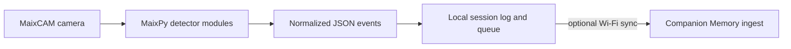
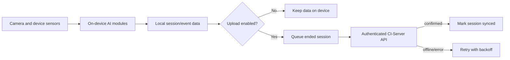

<h1 align="center">Companion Capture for MaixCAM</h1>

<strong>A comprehensive life-logging application for the Sipeed MaixCAM device using the MaixPy framework.</strong>

<a href="#documentation">Documentation</a> · <a href="https://docs.ci.computer/docs/reference/open-source-systems">Systems map</a>

  

https://wiki.sipeed.com/hardware/en/maixcam/index.html

This app targets **MaixPy v4** (the current, [MaixCDK](https://github.com/sipeed/MaixCDK)-based
SDK generation for MaixCAM/MaixCAM-Pro - not the older K210/`maixpy3` line). Update
device firmware via the MaixVision IDE or the [MaixPy releases page](https://github.com/sipeed/MaixPy/releases);
`maix` ships with that firmware and is not a pip package. See
[`maix.sys`](https://wiki.sipeed.com/maixpy/api/maix/sys.html) and
[`maix.network.wifi`](https://wiki.sipeed.com/maixpy/api/maix/network/wifi.html)
for the device-identity and Wi-Fi APIs this app builds on.

## Features

| Feature | What it provides |
|---|---|
| **Camera perception** | Run independent MaixPy detector modules against MaixCAM frames. |
| **Unified event records** | Normalize detector output and save session JSON locally. |
| **Optional Memory sync** | Queue session uploads and retry when Wi-Fi returns. |

## Project Overview

This application detects and records objects, people, places, things, and events through continuous AI-powered analysis, outputting all results in JSON format for local storage and remote synchronization.

## Connecting to CI-Server

Each ended capture session is queued for upload to your
[CI-Server](https://github.com/companionintelligence/CI-Server) instance's `/v1` ingest
plane (the same capture-event pipeline CI-Capture, the desktop agent, uses). Point a
device at a server by setting, in its config file (`/sd/companion_config.json`):

- `network.endpoint_url` - your CI-Server's base URL, e.g. `https://companion.example.com`
  (no path suffix - the app appends `/v1/events` etc. itself)
- `network.api_key` - a CI-Server API key with `capture` write scope for this device
- `network.upload_enabled` - `true` to turn syncing on

Uploads are skipped while Wi-Fi is disconnected and retried with backoff; nothing is
deleted locally until a batch is confirmed uploaded. See
[`docs/ci-server-api.md`](docs/ci-server-api.md) for the wire format.

## AI detection

Object classification, face recognition + emotion, object tracking &
counting, OCR, hand landmarks + gesture, human pose classification, and
audio recording / voice recognition are all implemented against the real
`maix.nn`/`maix.audio` APIs under [`src/ai/`](src/ai/) - see
[`docs/architecture.md`](docs/architecture.md) for the module map and the
unified event schema they all share, and
[`docs/research-notes.md`](docs/research-notes.md) for how other
MaixCAM/MaixPy projects handle running several NN models on one device.

## Documentation

- [`docs/user-guide.md`](docs/user-guide.md) - setup and day-to-day use
- [`docs/architecture.md`](docs/architecture.md) - code structure, data flow, event schema
- [`docs/configuration.md`](docs/configuration.md) - every `companion_config.json` field
- [`docs/ci-server-api.md`](docs/ci-server-api.md) - the CI-Server wire format
- [`docs/troubleshooting.md`](docs/troubleshooting.md) - common issues
- [`docs/deployment.md`](docs/deployment.md) - deployment checklist, monitoring, backup/recovery
- [`docs/research-notes.md`](docs/research-notes.md) - findings from other MaixCAM/MaixPy projects
- [`docs/scan-to-provision.md`](docs/scan-to-provision.md) - a QR-based device-enrolment design (not yet built)
- [`CHANGELOG.md`](CHANGELOG.md) - release notes

<!-- companion-hub-readme-deep-review -->

## How it fits together

MaixPy runs detectors on device frames, records normalized session events locally and sends queued uploads to the configured Memory API when networking is enabled.

## Device compatibility and event flow

| Area | Supported/documented path |
|---|---|
| Device | MaixCAM and MaixCAM-Pro |
| Runtime | MaixPy v4 firmware with the MaixCDK-based SDK |
| Firmware provisioning | MaixVision or the MaixPy device releases; firmware is not installed with `pip` |
| Configuration | `/sd/companion_config.json` on the device |
| Server sync | Optional, authenticated CI-Server event upload; uploads ended sessions and retries when offline |

The scan-to-provision workflow is a design proposal, not an implemented setup path. See the configuration and troubleshooting guides before changing network or upload settings.

